# Каскад Gatekeeper

Gatekeeper не обязан быть один. Несколько экземпляров можно соединить в каскад: основной даёт единую точку доступа ко всем данным, а edge стоит рядом с устройством.

<!-- archtale:diagram cascade -->


```model cascade
warlock -> main-gatekeeper: чтение тегов (OPC UA)
main-gatekeeper "Основной Gatekeeper" [gk] -> opc-ua-gate "OPC UA" [gate]
opc-ua-gate -> s7-edge-gatekeeper "Edge Gatekeeper (S7)" [gk]: подписка, пачка раз в 1 с
opc-ua-gate -> modbus-edge-gatekeeper "Edge Gatekeeper (Modbus)" [gk]: подписка
opc-ua-gate -> opc-ua-plc "ПЛК с OPC UA-сервером" [imp]: подписка
s7-edge-gatekeeper -> s7-connection "S7 connection" [gate]: опрос раз в 10 мс
s7-connection -> s7-plc "ПЛК S7" [imp]
modbus-edge-gatekeeper -> modbus-tcp: опрос
modbus-tcp -> modbus-plc "ПЛК Modbus" [imp]
```

Стрелка идёт от инициатора обращения.

## Зачем

Допустим, данные с ПЛК нужно собирать раз в 10 мс по S7 connection, а основной Gatekeeper находится в датацентре. Прямая связь между ними создаёт проблемы:

- S7 connection идёт по инфраструктурной сети без шифрования.
- Частый опрос нагружает сеть.

## Решение

Рядом с ПЛК ставится ещё один Gatekeeper с двумя сетевыми интерфейсами:

- **Полевой:** edge открывает gate до ПЛК и собирает данные с нужной частотой.
- **Инфраструктурный:** edge отдаёт данные основному Gatekeeper по OPC UA с шифрованием.

Основной Gatekeeper хранит общий namespace и обслуживает warlock'ов. Для него edge выглядит как обычный OPC UA-сервер, поэтому edge и ПЛК со встроенным OPC UA-сервером подключаются одинаково. ПЛК, которому достаточно прямого OPC UA-соединения, отдельный edge не нужен.

## Безопасность

Каскад разделяет каналы по уровню защиты:

- **Gatekeeper — Gatekeeper:** защищённый канал OPC UA. Его можно пускать через инфраструктуру предприятия.
- **Gatekeeper — ПЛК:** обычно не защищён, поэтому остаётся в полевой сети.

Edge стоит на границе этих сетей: незащищённый полевой протокол заканчивается на нём и не выходит в инфраструктурную сеть.

## Частота сбора и передачи

Эти частоты не связаны между собой. В подписке OPC UA они задаются отдельно:

- `SamplingInterval` — как часто значение попадает в очередь, например раз в 10 мс.
- `PublishingInterval` — как часто накопленные значения уходят по сети, например раз в 1 с.

В этом примере за одну передачу уходит около 100 значений каждого тега. Для этого `QueueSize` должен быть не меньше 100, иначе часть значений потеряется. Сеть получает редкие большие пачки вместо постоянного потока мелких запросов.
