# Как открыть врата?

<!-- archtale:diagram open-gate -->


```model open-gate
warlock -> gatekeeper: чтение тегов (OPC UA)
gatekeeper -> plc-config: адреса и пространство имён
gatekeeper -> modbus-tcp: запрос данных
modbus-tcp -> plc: чтение регистров
```

Стрелка идёт от инициатора обращения.
